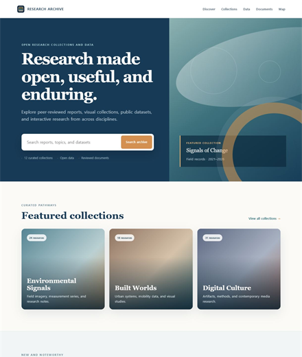
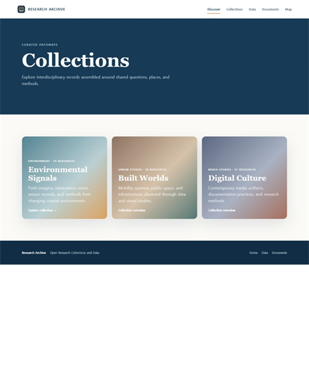
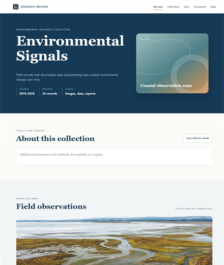
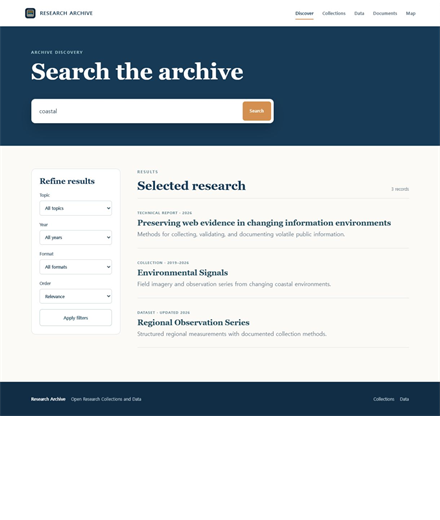
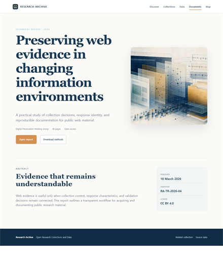
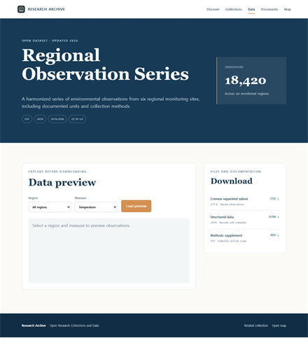
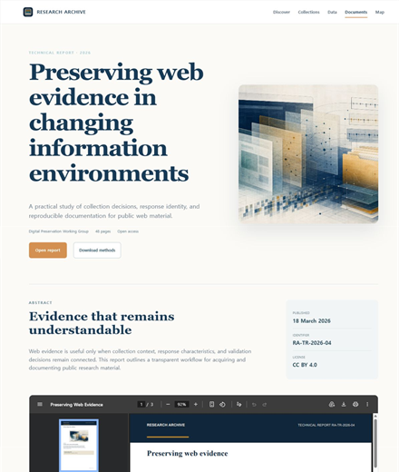
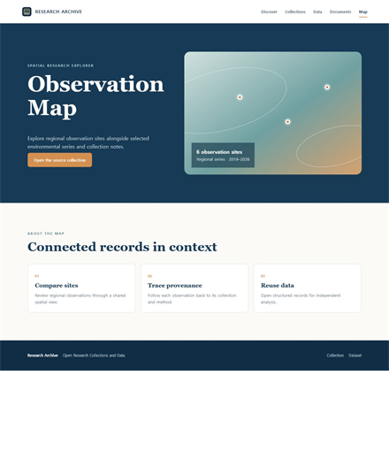

# Cache Recovery evaluation

This directory contains the public Cache Recovery evaluation workflow, the
Research Archive substrate, and the packaged final-20 evidence. Reproduction
uses the repository-root `przma_cache_evaluation.ps1` launcher after configuring
a local `.env` and evaluation Config. Reviewers should not invoke an internal
nested launcher.

## Prerequisites

- A Windows host with Python 3.10 or newer, VMware Workstation and `vmrun`, and
  Git LFS.
- A prepared Windows VM containing Chromium or Chrome and the PrZMA VM Agent.
- A locally obtained ChromeCacheView executable and its actual SHA-256 digest.
- API and VM credentials stored only in the local `.env`.
- A Config copied from
  [`cache_recovery/config.example.json`](cache_recovery/config.example.json) to
  `evaluation/local/evaluation.json`, with every placeholder replaced.
- `WEB_URL` set to the configured Research Archive host and port.

The example Config is intentionally incomplete and is expected to fail
Preflight until its VM paths, networking, ChromeCacheView path and digest, and
other placeholders are replaced.

## Reviewer workflow

Run these commands from the repository root:

```powershell
Copy-Item .env.example .env
New-Item -ItemType Directory -Force evaluation\local
Copy-Item evaluation\cache_recovery\config.example.json evaluation\local\evaluation.json

.\przma_cache_evaluation.ps1 -Mode Preflight
.\przma_cache_evaluation.ps1 -Mode Smoke
.\przma_cache_evaluation.ps1 -Mode Pilot -Count 3
.\przma_cache_evaluation.ps1 -Mode Freeze -PilotSummary .\evaluation\results\autonomous_pilot_summary_<id>.json -Approve
.\przma_cache_evaluation.ps1 -Mode Campaign
.\przma_cache_evaluation.ps1 -Mode PairedReplay -Selection .\evaluation\results\aggregate\final20_selection.json
.\przma_cache_evaluation.ps1 -Mode Verify -Evidence .\evaluation\evidence\final20
```

Before an evaluation run, `Preflight` checks that the Research Archive and
local execution prerequisites are ready. It runs the verification modules in
[`cache_recovery/verification/`](cache_recovery/verification/) and checks the
local configuration, credentials, VM and ChromeCacheView paths, tool identity,
network settings, and port availability. It may use temporary local test
fixtures and headless Chromium, but it does not boot the evaluation VM or begin
a Smoke, Pilot, or Campaign run.

`Smoke`, `Pilot`, and `Campaign` visibly start the local Research Archive
server, boot or connect A1, deploy or contact the VM Agent, and use a fresh,
visible Chromium profile for every run. The Tool Manual Interpreter (TMI)
interprets the frozen ChromeCacheView manual and produces the workflow; within
the permitted boundary, the VM Agent autonomously selects parameters and
actions. A successful final `browser.close` triggers the single end-of-run
cache snapshot. ChromeCacheView then exports its results, objects are extracted,
and comparison evidence is written.

Pilot defaults to three runs. Freeze requires a passing Pilot summary and
explicit `-Approve`; Campaign is fixed at 20 runs. `PairedReplay` replays the
selected 20 recorded action sequences without model calls.

`Verify` checks the packaged population, required evidence, portable metadata,
snapshot ZIP membership, exclusions, and every SHA-256 hash. It does not rerun
model calls or recompute statistical intervals.

## Research Archive

The bundled Research Archive is the controlled web substrate used by the
evaluation.

The images below are representative full-page captures of its principal
functional areas, rather than an exhaustive inventory of every interaction or
runtime state.

<table>
  <tbody>
    <tr>
      <th width="25%">Entry page</th>
      <th width="25%">Collections index</th>
      <th width="25%">Collection detail</th>
      <th width="25%">Search and refinement</th>
    </tr>
    <tr>
      <td align="center" valign="top"><a href="screenshots/research_archive_entry_fullpage.png"></a></td>
      <td align="center" valign="top"><a href="screenshots/research_archive_collections_fullpage.png"></a></td>
      <td align="center" valign="top"><a href="screenshots/research_archive_collection_detail_fullpage.png"></a></td>
      <td align="center" valign="top"><a href="screenshots/research_archive_search_fullpage.png"></a></td>
    </tr>
    <tr>
      <th width="25%">Document detail</th>
      <th width="25%">Data preview and downloads</th>
      <th width="25%">Inline PDF view</th>
      <th width="25%">Standalone map view</th>
    </tr>
    <tr>
      <td align="center" valign="top"><a href="screenshots/research_archive_document_detail_fullpage.png"></a></td>
      <td align="center" valign="top"><a href="screenshots/research_archive_data_fullpage.png"></a></td>
      <td align="center" valign="top"><a href="screenshots/research_archive_inline_pdf_fullpage.png"></a></td>
      <td align="center" valign="top"><a href="screenshots/research_archive_standalone_map_fullpage.png"></a></td>
    </tr>
  </tbody>
</table>

The screenshots and public source demonstrate the evaluated substrate. Merely
opening the preview does not perform the baseline or statistical evaluation.
See the [Research Archive source and site documentation](cache_recovery/research_archive/README.md)
and the [packaged final-20 evidence](evidence/final20/README.md).

## Responsible data handling

Forensic samples can preserve account, session, message, URL, browsing, or
other personal data. Treat all raw sample material as sensitive, review it
before redistribution, and keep local `.env` and VM configuration out of any
sample or published bundle.
